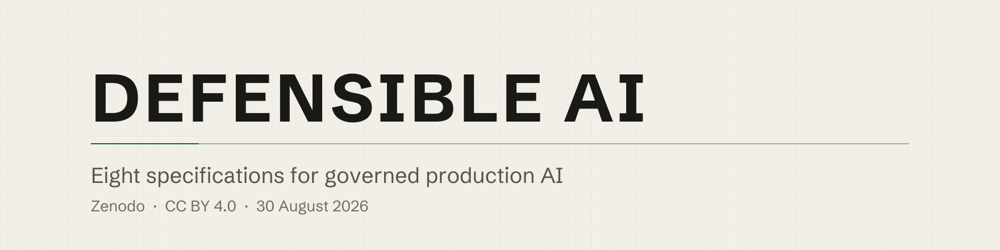

<div align="center">

<picture>
  <source media="(prefers-color-scheme: dark)" srcset="assets/banner-dark.svg">
  
</picture>

**Eight specifications for governed production AI.**

Nabeel A. Khan · iSystematic Inc. · published to Zenodo on 30 August 2026 · CC BY 4.0

[](https://creativecommons.org/licenses/by/4.0/)
[](https://doi.org/10.5281/zenodo.22170112)
[](https://orcid.org/0009-0005-5364-914X)

</div>

> [!IMPORTANT]
> **Zenodo is canonical. This repository is a convenience mirror.** Where a file here and the Zenodo record differ, the record governs. Every PDF in `pdf/` is fetched from its own Zenodo record rather than copied from a local build, because a local file is not the published artifact.

---

## Start with the Registry

Eight documents is too many to choose between blind, and the corpus answers that itself. **The Defensible AI Framework Registry** is the entry point. It names every framework in the governance family, defines each one, states the thirty-one relationships between them, and records for each entry what it requires as evidence, what its limitations are, and the condition that would falsify it.

Read the Registry when you want the map. Read one of the other seven when you already know which question you are asking.

### Which one do I need

| Your question | Start here |
|---|---|
| Which frameworks exist, what each one means, and how they compose | [Registry](https://doi.org/10.5281/zenodo.22170112) |
| How mature is our AI governance, and which altitude is failing | [MESA](https://doi.org/10.5281/zenodo.22109836) |
| How does a model reach production, and which person approved it | [Five-Gate](https://doi.org/10.5281/zenodo.22170122) |
| How do we assess a third-party AI system, model or API before we buy it | [AVRF](https://doi.org/10.5281/zenodo.22170146) |
| We answer to a Sharia Supervisory Board as well as to a regulator | [SACF](https://doi.org/10.5281/zenodo.22170143) |
| How do we build the platform the governance runs on | [Pattern Language](https://doi.org/10.5281/zenodo.22109864) |
| How do we split an agent workflow so a failure is attributable to one role | [PEVG](https://doi.org/10.5281/zenodo.22170132) |
| What authority does an agent hold, and what can the institution revoke | [PARA](https://doi.org/10.5281/zenodo.22170139) |

---

## The eight

| Work | Version | Concept DOI | PDF |
|---|---|---|---|
| [A Pattern Language for Production LLM Platforms: Governed Routing, Agent Orchestration, and AI-Native Delivery](pdf/pattern-language-specification-v1.1.pdf) | 1.1 | [10.5281/zenodo.22109864](https://doi.org/10.5281/zenodo.22109864) | 2026-08-30 |
| [The MESA Framework: A Four-Altitude Diagnostic Model for Institutional AI Governance](pdf/mesa-framework-specification-v1.1.pdf) | 1.1 | [10.5281/zenodo.22109836](https://doi.org/10.5281/zenodo.22109836) | 2026-08-30 |
| [The Five-Gate Deployment Model: A Deployment Discipline for AI Systems](pdf/five-gate-deployment-model-specification-v1.0.pdf) | 1.0 | [10.5281/zenodo.22170122](https://doi.org/10.5281/zenodo.22170122) | 2026-08-30 |
| [PEVG: Planner, Executor, Verifier, Generator. Four Contracts That Make a Failure Attributable to One Role](pdf/pevg-specification-v1.0.pdf) | 1.0 | [10.5281/zenodo.22170132](https://doi.org/10.5281/zenodo.22170132) | 2026-08-30 |
| [PARA: Perception, Action, Reasoning, Adaptation. Four Faculties an Institution Can Revoke](pdf/para-specification-v1.0.pdf) | 1.0 | [10.5281/zenodo.22170139](https://doi.org/10.5281/zenodo.22170139) | 2026-08-30 |
| [The Sharia AI Compliance Framework: A Dual-Authority Governance Architecture for Islamic Finance](pdf/sacf-specification-v1.0.pdf) | 1.0 | [10.5281/zenodo.22170143](https://doi.org/10.5281/zenodo.22170143) | 2026-08-30 |
| [AVRF: AI Vendor Risk Framework. The AI Vendor Due-Diligence Questionnaire](pdf/avrf-questionnaire-specification-v1.0.pdf) | 1.0 | [10.5281/zenodo.22170146](https://doi.org/10.5281/zenodo.22170146) | 2026-08-30 |
| [The Defensible AI Framework Registry: Definitions and Relationships for the Governed Production AI Discipline](pdf/defensible-ai-framework-registry-specification-v1.0.pdf) | 1.0 | [10.5281/zenodo.22170112](https://doi.org/10.5281/zenodo.22170112) | 2026-08-30 |

Each link is the **concept DOI**, which always resolves to the latest version of that work. Cite it unless you need to pin one specific version. The table gives each record's catalogue title; a PDF carries the typeset title of the document itself.

<details>
<summary><strong>What each one contains, in one line</strong></summary>

<br>

**Registry.** Nine frameworks, thirty-one relationship edges, and a machine-readable layer validated against a published schema so that a reader can check the registry rather than trust it.

**Pattern Language.** Seventeen patterns across infrastructure, application and operations, each declaring the boundary it fixes, the optimizer it frees, and the evidence proving the boundary held.

**MESA.** Four governance altitudes, the Regulatory Floor, the Strategic Compass, Operational Machinery and the Technical Substrate, with maturity reported as a vector across the four rather than as one organizational grade.

**Five-Gate.** G1 Data and Design, G2 Validation, G3 Approval, G4 Deployment, G5 Operation. Each gate carries entry criteria, exit criteria, a rejection path, a required evidence record, and one accountable person rather than a committee.

**AVRF.** Fifty-six questions in seven sections, each with a fixed answer format and a stated evidence expectation. An answer supplied without its evidence is recorded as an assertion and not as a finding.

**SACF.** How an institution with two binding authorities, a regulator and a Sharia Supervisory Board, carries both through one set of governance machinery rather than two parallel processes.

**PEVG.** Four roles with four contracts, and the argument that the verifier holds the epistemic boundary but must not also hold the operational one.

**PARA.** Four faculties assigned as authorities rather than as activities. Two of the four write, and those two are the two that need guardrails.

</details>

---

## Two families, two governing documents

The corpus splits in two, and the split is normative rather than editorial.

The **governance family** is the nine frameworks the Registry catalogues. It is calibrated to regulated institutions operating AI systems under at least one binding authority source. Its canonical source is the Registry.

The **engineering family** is A Pattern Language for Production LLM Platforms and the constructs it defines or names: **PEVG**, **PARA**, the **Boundary Invariant** and the **BOE Declaration**. Its canonical source is that specification.

Where the two describe the same relationship, the Registry governs for the governance family and the Pattern Language specification governs for the engineering family. Two documents asserting the same relationships will otherwise drift, and the drift is found by a reader rather than by an author.

Between them the families rest on two propositions, each published and citable on its own:

> **MESA.** Institutional AI governance is an alignment condition across four altitudes, so maturity is reported as a per-altitude profile rather than as a single grade.

> **The Boundary Invariant.** A boundary is a clause the optimizer may not cross, and everything else is optimization.

Those two fix the directions in which the composed system is read. **Authority flows down. Evidence flows up.** The asymmetry is the point, because authority can be granted without evidence, and frequently is, which is what a governance programme looks like when it is documented but not enforced.

---

## The evidence position, stated plainly

These are architectural claims. Coherence can be checked from the documents. Correctness cannot.

**No institution unconnected to the author has been observed operating the composed set.** Each framework has been applied in the author's practice. The set as an architecture has not been evaluated by anyone outside it, and no third party has published a result obtained under any of these documents.

The Pattern Language grades every one of its seventeen patterns on a four-level evidence scale:

| Level | Meaning |
|---|---|
| **E0** | Conceptual only. No external implementation evidence for the mechanism or the combination. |
| **E1** | Published mechanism. The underlying mechanism exists in published research or documented practice; the governance addition specified here is not separately documented. |
| **E2** | Documented implementation. The combined mechanism, including its governance addition, has been implemented and documented. |
| **E3** | Independent production evidence. Evidence from an implementation outside the author's own work. |

**No pattern in the catalogue reaches E3.** Two reach E2 and fifteen are at E1. That is the single most important fact about the evidence base, and it is stated here rather than left to be inferred.

The Registry uses a different field for a different purpose. It records each entry's **specification status**, because the nine frameworks are not all specified to the same depth. Four of the nine are deposited as standalone specifications and carry their own DOI. For the other five the authoritative treatment is a named book chapter, and the entry is the most complete normative statement available in citable form. A reader implementing from one of those five entries is implementing from a summary, and the status field says so rather than smoothing it over.

Two limitations depend on an authority that has not acted, which is what separates them from the rest. **No Sharia Supervisory Board has reviewed or endorsed SACF.** **No trademark clearance search has been completed on the Five-Gate name.** Neither can be resolved by the author acting alone.

A registry maintained by its own beneficiary is not independent. The identifiers cannot be renumbered, the consolidation notice is dated, the falsification conditions are published, and the data layer validates against a published schema. Those four make the instrument **auditable**, which is a lesser property than independent, and the Registry claims only the lesser one.

---

## What these are not

> [!WARNING]
> **These are specifications, not certification schemes.** No conformity assessment, endorsement or accreditation is offered or implied by any document here, and no standards body has endorsed any of them. The works are self-deposited on Zenodo and have not been peer reviewed.

They are also not statements of regulatory compliance, not maturity assessments, not empirical claims, and not replacements for ISO/IEC 42001 or the NIST AI Risk Management Framework, both of which operate at institutional altitude and are mapped inside the specifications that touch them.

Each document states its own non-goals in its opening sections and its own limitations near the end. Read the limitations section before relying on any of it. In SACF the reading order is deliberately inverted for this reason: the limitations come before the proposal.

---

## Companion artifacts, in preparation

Some of what this family needs is not published yet.

- [ ] **The Five-Gate gate record templates**, one per gate, so that two institutions operating the model produce records that can be compared.
- [ ] **The MESA assessment instrument**, the fifty questions with all anchors on which a conformant MESA assessment depends.

They will be published together rather than piecemeal, because they share a surface with the framework pages and the machine-readable layer, and releasing one without the others would reproduce the drift these specifications exist to prevent. When they ship they will appear in this repository and be callable over the Model Context Protocol at [mcp.nabeelkhan.com/api/mcp](https://mcp.nabeelkhan.com/api/mcp).

No date is stated, and nothing in the published specifications depends on retrieving these from any particular location. The specifications are complete as deposited. The companion artifacts make them cheaper to adopt, not more correct.

---

## Citing

Cite the **concept DOI**, never a version DOI. The concept DOI resolves to the latest version of a record; a version DOI pins one snapshot and will not follow a correction.

> Khan, N. A. (2026). *The Defensible AI Framework Registry: Definitions and Relationships for the Governed Production AI Discipline.* Zenodo. https://doi.org/10.5281/zenodo.22170112 Licensed CC BY 4.0.

```bibtex
@misc{khan2026registry,
  author    = {Khan, Nabeel A.},
  title     = {The Defensible AI Framework Registry: Definitions and
               Relationships for the Governed Production AI Discipline},
  year      = {2026},
  publisher = {Zenodo},
  version   = {1.0},
  doi       = {10.5281/zenodo.22170112},
  url       = {https://doi.org/10.5281/zenodo.22170112},
  note      = {Licensed CC BY 4.0}
}
```

Substitute the title, version and concept DOI of whichever work you are citing from the table above. `CITATION.cff` in this repository carries the machine-readable form, and each PDF states its own citation block, DOI and licence on its title page.

---

## Copyright, licence and trademarks

**© 2026 Nabeel A. Khan.** All rights reserved except as granted below.

Every work here is licensed under [CC BY 4.0](https://creativecommons.org/licenses/by/4.0/). The full legal code is in [LICENSE](LICENSE). You are free to **share** and to **adapt** the material for any purpose, including commercially, provided you give appropriate credit, link to the licence, and indicate whether changes were made.

**What the licence does not cover.** Trademarks are not licensed. The following are trademarks of the author and iSystematic Inc., and the CC BY grant conveys no rights in them:

| | |
|---|---|
| MESA Framework | AI Incident Response Protocol (AIRP) |
| MESA MRM Framework | Five-Gate Deployment Model |
| AI Data Governance Framework | Sharia AI Compliance Framework (SACF) |
| AI Vendor Risk Framework (AVRF) | Cross-Border AI Architecture Patterns |

No registered-mark symbol is used on any of them, because no registration has issued.

**PEVG**, **PARA**, the **AI Governance Operating Model**, the **Boundary Invariant** and the **BOE Declaration** are deliberately unmarked. That is a decision rather than an omission. A mark on a design pattern suppresses the citation the pattern needs in order to spread, and the defensibility of those names rests on a dated publication record rather than on a symbol. They are offered for use, teaching, assessment, extension and criticism by anyone, with attribution and nothing further. Each specification states this in its own terms.

---

## Repository contents

```
pdf/            The eight specifications, each fetched from its own Zenodo record
assets/         Banner artwork, light and dark
LICENSE         The CC BY 4.0 legal code
CITATION.cff    Machine-readable citation metadata
README.md       This file
```

The mirror is assembled rather than maintained by hand. The published set is derived from the deposit identifiers and confirmed against the Zenodo API on every run, each PDF is downloaded from its record and its byte count checked against what the record states, and a build fails rather than publishing a file that no record accounts for. That is why the Zenodo record governs and this repository does not.

---

## Questions, corrections and independent evidence

Every specification here poses research questions it does not answer, and the most valuable of them can only be answered from outside the author's practice. Anyone able to supply an implementation profile, a real corpus of vendor responses, a board's engagement with SACF, or a deployment result that would move a pattern toward E2 or E3 is invited to make contact.

- Corrections to this repository: open an issue on [GitHub](https://github.com/DrNabeelKhan/defensible-ai/issues).
- Research contact and correspondence: [nabeelkhan.com/contact](https://nabeelkhan.com/contact) or the ORCID record below.
- Errata against a published record: report through the contact page, and the correction is made on Zenodo first, because Zenodo is the record and this repository is a convenience.

---

<div align="center">

**Nabeel A. Khan**
Founder and Solutions Architect, iSystematic Inc., Canada
[ORCID 0009-0005-5364-914X](https://orcid.org/0009-0005-5364-914X) · [nabeelkhan.com](https://nabeelkhan.com)

</div>
